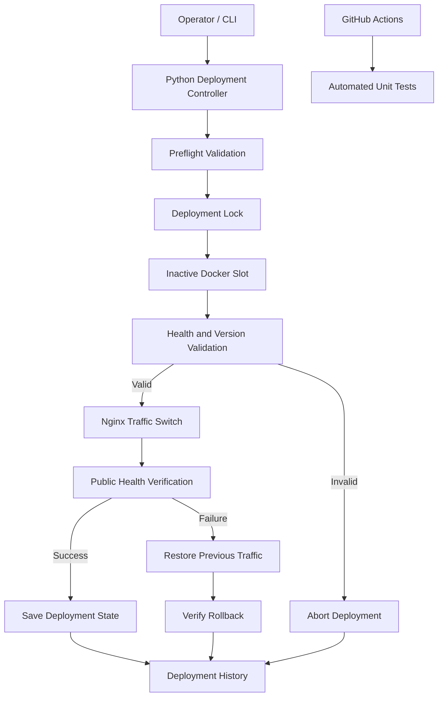

# ReleaseGuard
### Zero-Downtime Docker Deployment and Automatic Rollback

ReleaseGuard is a Docker deployment automation project that demonstrates blue-green deployments, application health verification, traffic switching, rollback handling, deployment state tracking, and concurrency protection.

It is designed as a practical DevOps/SRE learning project using Docker, Python, FastAPI, Nginx, and GitHub Actions.

## Problem Statement

Replacing a running application during deployment can introduce downtime or expose users to an unhealthy release. A deployment process also needs to avoid recording a release as successful before the new version has been verified.

ReleaseGuard addresses these concerns by deploying to an inactive application slot, validating the candidate, switching traffic through Nginx, and checking the public health endpoint before recording success.

## Architecture



See [the architecture diagram source](docs/architecture.mmd) for the editable Mermaid version.

## Main Features

- **Blue-green deployment:** maintains separate blue and green application slots.
- **Preflight checks:** validates deployment state and checks that the requested image exists locally before replacing a slot.
- **Health and version validation:** checks the candidate application before switching traffic.
- **Nginx traffic routing:** routes requests to the active application slot.
- **Automatic rollback handling:** attempts to restore the previous traffic route when post-switch verification fails.
- **Deployment state tracking:** records the active slot and deployed version.
- **Deployment history:** records successful and failed deployment attempts.
- **Concurrency protection:** uses a file lock to serialize deployment operations.
- **Automated tests:** uses Python's built-in `unittest` framework.
- **Continuous integration:** GitHub Actions runs the unit tests on pushes and pull requests to `main`.

## Technology Stack

| Technology | Purpose |
|---|---|
| Docker | Application containers and images |
| Docker Compose | Supporting service orchestration |
| Python | Deployment controller and automation |
| FastAPI | Demonstration application and health endpoint |
| Nginx | Traffic routing between application slots |
| Bash | Terminal-based operations |
| Git and GitHub | Version control and repository hosting |
| GitHub Actions | Automated test execution |

## Project Structure

```text
ReleaseGuard/
├── app/
│   ├── app.py
│   └── Dockerfile
├── controller/
│   ├── deployer.py
│   ├── docker_manager.py
│   ├── deployment_lock.py
│   ├── state_manager.py
│   ├── status.py
│   └── requirements.txt
├── nginx/
│   └── nginx.conf
├── scripts/
├── tests/
│   ├── test_deployer.py
│   ├── test_deployment_lock.py
│   ├── test_health.py
│   └── test_preflight.py
├── state/
│   └── history/
├── docs/
│   └── architecture.mmd
├── compose.yaml
└── .github/
    └── workflows/
        └── ci.yml
```

Runtime deployment state and history are local files and are excluded from Git using `.gitignore`.

## How Deployment Works

1. The operator requests a tagged Docker image.
2. The controller validates the image tag and acquires the deployment lock.
3. It checks the recorded deployment state and confirms the image exists locally.
4. It identifies the inactive application slot and replaces that slot's container.
5. The controller checks the candidate's health and expected version.
6. If validation succeeds, the controller switches Nginx traffic to the candidate.
7. It verifies the application's public health endpoint.
8. On success, it saves the new active slot and version and records the result.
9. If a later deployment step fails, it attempts to restore the previous traffic route and verifies the rollback.

A rollback attempt is not the same as a guaranteed rollback: if restoration cannot be verified, the controller reports that failure.

## Prerequisites

- Linux environment with Docker Engine installed and running
- Docker Compose plugin, if using the supplied Compose configuration
- Python 3.9 or a compatible environment for the project
- Git
- Permission to access the Docker daemon

The controller uses Linux file locking (`fcntl`) for deployment serialization.

## Setup

Clone the repository and enter the project directory:

```bash
git clone https://github.com/kartikay4577-xtreme/releaseguard.git
cd releaseguard
```

Create and activate a Python virtual environment:

```bash
python3 -m venv .venv
source .venv/bin/activate
```

Install controller dependencies:

```bash
python -m pip install --upgrade pip
pip install -r controller/requirements.txt
```

Ensure Docker is running and inspect the available images:

```bash
docker info
docker image ls
```

Build the application image if required, using the repository's application Dockerfile and the intended image tag. Confirm that the image tag matches the one supplied to the deployment controller.

Review `compose.yaml` and `nginx/nginx.conf` before starting or changing services.

## Read-Only Inspection Commands

Show saved deployment state and container status:

```bash
python -m controller.status status
```

Show the latest 10 deployment history entries:

```bash
python -m controller.status history
```

Show the latest 20 entries:

```bash
python -m controller.status history --limit 20
```

## Run the Unit Tests

Run all tests without deploying or changing application containers:

```bash
python -m unittest discover -s tests -v
```

Compile the controller modules:

```bash
python -m py_compile controller/*.py
```

Check for whitespace errors in the Git diff:

```bash
git diff --check
```

GitHub Actions also runs the test suite for pushes and pull requests targeting `main`.

## Configuration and Runtime Data

- `state/deployment.json` stores the active slot and version.
- `state/history/deployments.log` stores deployment history.
- `state/deployment.lock` coordinates concurrent controller invocations.
- `.gitignore` excludes local runtime state from version control.

Keep runtime state and history backed up if they are important to your environment. This implementation uses local files; it does not provide distributed locking or replicated state storage.

## Current Scope and Limitations

ReleaseGuard is a demonstration project, not a complete production deployment platform.

- Image preflight checks local image availability, not image provenance or vulnerability status.
- Local file locking protects cooperating controller processes on the same Linux host; it is not a distributed lock.
- State and history are local files, not a replicated database.
- Rollback depends on the previous application and traffic route being recoverable and verifiable.
- Production adoption would require additional security controls, monitoring, access management, secret handling, and environment-specific testing.

## Skills Demonstrated

- Docker container lifecycle and image management
- Blue-green deployment concepts
- Reverse proxy and traffic routing with Nginx
- Python automation and subprocess handling
- Health checks and release validation
- Failure handling and rollback verification
- File locking and concurrency control
- Unit testing with mocks
- Git workflows and CI with GitHub Actions

## Future Improvements

- Image vulnerability scanning and digest-based releases
- Deployment metrics and structured JSON logs
- Configurable health-check retries and timeouts
- Persistent, centralized state and history
- Integration tests using an isolated Docker environment
- Deployment approvals and environment-specific configuration

## Author

**Kartikay Yadav**

B.Tech Computer Science and Engineering

GitHub: [kartikay4577-xtreme](https://github.com/kartikay4577-xtreme)
