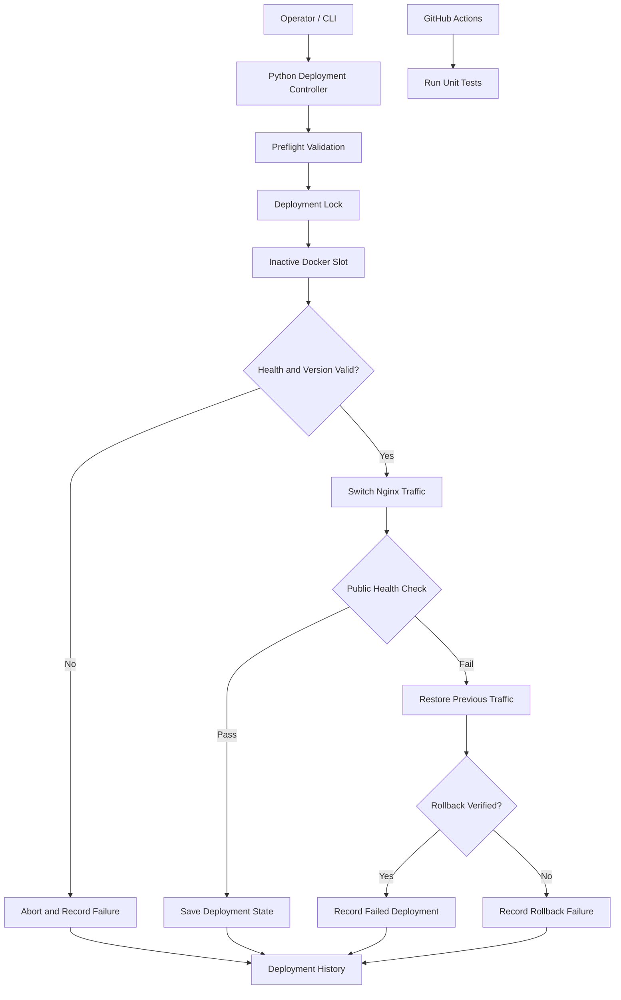

# ReleaseGuard

### Zero-Downtime Docker Deployment and Automatic Rollback

ReleaseGuard is a DevOps/SRE learning project that automates blue-green Docker deployments using Python, Docker, FastAPI, and Nginx. It demonstrates release validation, traffic switching, rollback verification, deployment state tracking, concurrency protection, and automated testing.

**Repository:** [github.com/kartikay4577-xtreme/releaseguard](https://github.com/kartikay4577-xtreme/releaseguard)

## Problem Statement

Deploying a new application version can introduce downtime or expose users to an unhealthy release. A reliable deployment process should validate the candidate release, verify public traffic after switching, and attempt to restore the previous version if deployment fails.

ReleaseGuard implements this workflow by deploying to the inactive application slot, validating its health and version, switching traffic through Nginx, and recording the result.

## Architecture



See [`docs/architecture.mmd`](docs/architecture.mmd) for the editable Mermaid diagram.

## Features

- **Blue-green deployment:** maintains separate blue and green application slots.
- **Preflight validation:** checks saved deployment state and confirms the requested Docker image exists locally.
- **Health and version validation:** verifies the candidate application before routing traffic to it.
- **Nginx traffic switching:** changes the active application route through the Nginx configuration.
- **Automatic rollback handling:** attempts to restore the previous route when post-switch verification fails.
- **Rollback verification:** checks whether traffic has returned to the previously recorded version and records rollback failures.
- **Deployment state tracking:** stores the active slot and version.
- **Deployment history:** records successful and failed deployment attempts.
- **Concurrency protection:** uses a Linux file lock to serialize cooperating deployment processes.
- **Automated testing:** tests deployment behavior, health checks, preflight validation, and deployment locking.
- **Continuous integration:** GitHub Actions runs the automated test suite.

## Technology Stack

| Technology | Purpose |
|---|---|
| Docker | Application images and containers |
| Docker Compose | Nginx service configuration |
| Python | Deployment controller and automation |
| FastAPI | Demo application and health endpoint |
| Nginx | Reverse proxy and traffic routing |
| `unittest` and mocks | Automated testing |
| Git and GitHub | Version control and repository hosting |
| GitHub Actions | Continuous integration |

## Project Structure

```text
ReleaseGuard/
├── app/
│   ├── app.py
│   ├── Dockerfile
│   ├── .dockerignore
│   └── requirements.txt
├── controller/
│   ├── deployer.py
│   ├── deployment_lock.py
│   ├── docker_manager.py
│   ├── docker_test.py
│   ├── health.py
│   ├── history.py
│   ├── nginx_manager.py
│   ├── state_manager.py
│   ├── status.py
│   ├── __init__.py
│   └── requirements.txt
├── nginx/
│   └── nginx.conf
├── tests/
│   ├── test_deployer.py
│   ├── test_deployment_lock.py
│   ├── test_health.py
│   └── test_preflight.py
├── docs/
│   └── architecture.mmd
├── state/
│   └── deployment.json
├── docker-compose.yml
├── .gitignore
└── README.md
```

Runtime state, lock files, and deployment history are local operational data and should not be committed.

## Deployment Workflow

1. The operator supplies a tagged Docker image to the deployment controller.
2. The controller validates the image tag and acquires the deployment lock.
3. Preflight checks validate the saved state and confirm that the image exists locally.
4. The controller identifies the inactive slot and creates or replaces its container.
5. The candidate is checked for health and the expected application version.
6. If validation passes, the controller switches Nginx traffic to the candidate.
7. The public health endpoint is checked against the requested version.
8. On success, the controller saves the new active slot and version and records the successful deployment.
9. If a later step fails, the controller attempts to restore the previous traffic route and verify the previous version.
10. If rollback cannot be verified, the failure is reported and appended to the deployment history.

A rollback attempt is not a guarantee of recovery. ReleaseGuard reports when restoration cannot be verified.

## Prerequisites

- Linux environment
- Docker Engine installed and running
- Docker access permissions
- Python 3.9 or a compatible environment
- Git
- Docker Compose plugin for the supplied Compose configuration

The deployment lock uses Linux `fcntl` file locking and is intended for cooperating processes on the same host.

## Setup

Clone the repository:

```bash
git clone https://github.com/kartikay4577-xtreme/releaseguard.git
cd releaseguard
```

Create and activate a virtual environment:

```bash
python3 -m venv .venv
source .venv/bin/activate
```

Install controller dependencies:

```bash
python -m pip install --upgrade pip
pip install -r controller/requirements.txt
```

Check Docker availability and existing images:

```bash
docker info
docker image ls
```

The deployment controller expects the requested application image to exist locally. Build the image using `app/Dockerfile` and the tag appropriate for the release you intend to deploy.

Before starting or changing services, review `docker-compose.yml`, `nginx/nginx.conf`, and the deployment controller configuration. Do not start a second copy of services that are already running.

## Operational Commands

### Inspect deployment status

```bash
python -m controller.status status
```

### View deployment history

```bash
python -m controller.status history --limit 10
```

Change `10` to a larger number to inspect more entries.

### Check the public health endpoint

When the local deployment is running:

```bash
curl -i --max-time 5 http://127.0.0.1:8080/health
```

A healthy response includes a status and application version, for example:

```json
{
  "status": "healthy",
  "version": "v2"
}
```

The expected version depends on the currently active deployment.

## Testing

Run the complete unit test suite:

```bash
python -m unittest discover -s tests -v
```

Compile the Python modules:

```bash
python -m py_compile controller/*.py
```

Check the Git diff for whitespace errors:

```bash
git diff --check
```

The unit tests use mocks to exercise controller behavior without requiring each test to perform a real deployment. Passing unit tests do not, by themselves, prove that every failure scenario has been tested against live Docker and Nginx services.

GitHub Actions provides an additional automated CI check. See the repository's Actions tab for individual workflow results.

## Runtime State and History

The controller uses local files for operational state:

- `state/deployment.json` — active slot and deployed version.
- `state/history/deployments.log` — deployment attempts and outcomes.
- `state/deployment.lock` — deployment serialization lock.

The `.gitignore` configuration excludes runtime state from version control. Back up these files if they are important to your environment. Avoid manually editing deployment state while deployments are running.

## Current Scope and Limitations

ReleaseGuard is a demonstration project, not a complete production deployment platform.

- Image preflight checks local image availability, not image provenance or vulnerability status.
- File locking is local to cooperating processes; it is not a distributed lock.
- Deployment state and history are local files rather than replicated storage.
- Rollback depends on the previous application and traffic route remaining recoverable.
- Unit tests do not replace integration tests against real Docker and Nginx services.
- Production adoption would require additional security controls, monitoring, access management, secret handling, and environment-specific testing.

## Skills Demonstrated

- Docker image and container lifecycle management
- Blue-green deployment concepts
- Nginx reverse proxy and traffic routing
- Python automation and subprocess handling
- Health checks and release validation
- Failure handling and rollback verification
- File locking and concurrency control
- Unit testing with mocks
- Git workflows and CI with GitHub Actions

## Future Improvements

- Image vulnerability scanning and digest-based releases
- Structured JSON logs and deployment metrics
- Configurable health-check retries and timeouts
- Persistent or centralized deployment state
- Integration tests in an isolated Docker environment
- Deployment approvals and environment-specific configuration

## Author

**Kartikay Yadav**
B.Tech, Computer Science and Engineering

GitHub: [kartikay4577-xtreme](https://github.com/kartikay4577-xtreme)
